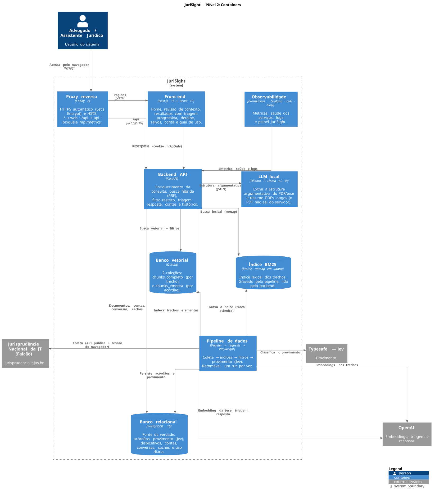

# JuriSight

[](https://sonarcloud.io/summary/new_code?id=ViniciusZnt_JuriSight)
[](https://sonarcloud.io/summary/new_code?id=ViniciusZnt_JuriSight)
[](https://sonarcloud.io/summary/new_code?id=ViniciusZnt_JuriSight)
[](https://sonarcloud.io/summary/new_code?id=ViniciusZnt_JuriSight)

**Pesquisa contextual de jurisprudência trabalhista com IA.** O advogado envia o PDF do caso e/ou a tese que quer sustentar e recebe acórdãos reais dos TRTs, ordenados pela relevância para aquela tese, cada um com fonte verificável e o desfecho do recurso.

| | |
|---|---|
| **Aplicação** | https://jurisight.16-5-6-82.sslip.io |
| **Documentação** | [Wiki](https://github.com/ViniciusZnt/JuriSight/wiki) |
| **Proposta (RFC)** | [`docs/RFC 4.2.md`](docs/RFC%204.2.md) |
| **Linha de projeto** | IA (Portfólio — Engenharia de Software, Católica SC) |

## Como funciona

1. **Contexto:** o PDF do caso é lido em memória e um LLM local (Llama 3.2 3B, via Ollama) extrai a estrutura argumentativa. O advogado revisa e corrige essa estrutura antes de buscar.
2. **Busca híbrida:** BM25 (termos exatos, como "NR-15") + busca vetorial no Qdrant (sentido da tese), fundidas por Reciprocal Rank Fusion, com filtro restrito opcional (dispositivos, expressões, tribunal, fase).
3. **Triagem por IA:** cada decisão recebe uma nota de 0 a 3 de relevância para a tese, e a lista é reordenada aos poucos. Uma resposta curta cita só decisões do resultado.
4. **Provimento:** cada acórdão traz o resultado do recurso, quem recorreu e a quem favoreceu, classificado pelo Jev (96% de acerto, contra 64,5% da regra anterior por regex).

O acervo tem ~69 mil acórdãos de 25 TRTs, coletados da Jurisprudência Nacional da Justiça do Trabalho por um pipeline próprio (Dagster).



## Stack

| Camada | Tecnologias |
|---|---|
| Backend | Python 3.13, FastAPI, PostgreSQL 16, Qdrant, bm25s |
| IA | Ollama (Llama 3.2 3B, local), OpenAI (`text-embedding-3-small`, `gpt-4o-mini`), Jev (Typesafe) |
| Frontend | Next.js 16, React 19, Tailwind |
| Dados | Dagster, requests + Playwright (coleta), SAC Chunking, Poly-Vector |
| Infra | Docker Compose, Caddy (HTTPS), GitHub Actions (CI/CD com runner self-hosted), SonarCloud |
| Observabilidade | Prometheus, Grafana, Loki, Alloy |

## Rodar localmente

Pré-requisitos: Python 3.13 com [uv](https://docs.astral.sh/uv/), Node.js 20+ com pnpm, Docker e uma chave da OpenAI com crédito. No Windows, use WSL2.

```bash
uv sync && (cd frontend && pnpm install)
cp .env.example .env        # preencha OPENAI_API_KEY e JWT_SECRET_KEY (openssl rand -hex 32)
docker compose up -d        # Postgres, Qdrant e Ollama
docker compose exec ollama ollama pull llama3.2:3b

# primeira vez: coletar e indexar (retomáveis)
uv run python scraper/run.py
uv run python indexing/run.py

./run.sh                    # backend em :8000 (docs em /docs) e frontend em :3000
```

Detalhes e opções em [Como Executar](https://github.com/ViniciusZnt/JuriSight/wiki/Como-Executar) e no manual de [Operação](https://github.com/ViniciusZnt/JuriSight/wiki/Operação).

## Testes

```bash
uv run pytest -q                # backend: ~650 testes (pytest)
cd frontend && pnpm test        # frontend: ~360 testes (Jest + Testing Library)
```

Nenhum teste precisa de chave nem de infraestrutura: OpenAI, Ollama, Qdrant e Postgres entram como fakes. Os testes de integração com o banco real só rodam com `DATABASE_URL`.

## CI/CD

O [workflow](.github/workflows/ci.yml) roda em todo PR e push:
- **backend** e **frontend:** testes com cobertura, e o build de produção do front;
- **sonar:** análise estática e cobertura no SonarCloud.

Em push na `main`, com tudo verde, o job **deploy** roda num runner self-hosted na VPS, que busca o job por HTTPS e executa `deploy/atualizar.sh` (sem SSH de entrada). Detalhes em [Infraestrutura e Deploy](https://github.com/ViniciusZnt/JuriSight/wiki/Infraestrutura-e-Deploy).

## Estrutura

```
scraper/        coleta e classificação do provimento (regex e Jev)
processing/     SAC Chunking e embeddings Poly-Vector
indexing/       Qdrant, BM25 e indexação incremental
query/          enriquecimento, busca, filtros, triagem, resposta e a API (FastAPI)
auth/           contas: Argon2id, JWT em cookie httpOnly (decisões em auth/DESIGN.md)
conversations/  histórico de buscas com versões
avaliacao/      conjunto-ouro e benchmark da busca
pipeline/       assets e jobs do Dagster
frontend/       interface Next.js
deploy/         Caddy, observabilidade, scripts de deploy, backup e runner
tests/          testes do backend
docs/           RFC, diagramas C4, deploy, avaliação e designs das decisões
```

## Documentação

| Assunto | Onde |
|---|---|
| Problema, requisitos, casos de uso | Wiki: [Problema e Objetivos](https://github.com/ViniciusZnt/JuriSight/wiki/Problema-e-Objetivos), [Requisitos](https://github.com/ViniciusZnt/JuriSight/wiki/Requisitos) |
| Arquitetura (C4) | Wiki: [Arquitetura](https://github.com/ViniciusZnt/JuriSight/wiki/Arquitetura); fontes em [`docs/Diagramas/C4-atual`](docs/Diagramas/C4-atual) |
| Pipeline de IA e validação | Wiki: [Pipeline de IA](https://github.com/ViniciusZnt/JuriSight/wiki/Pipeline-de-IA), [Avaliação e Validação](https://github.com/ViniciusZnt/JuriSight/wiki/Avaliação-e-Validação) |
| Decisões técnicas | Wiki: [Decisões Técnicas](https://github.com/ViniciusZnt/JuriSight/wiki/Decisões-Técnicas); designs em [`docs/superpowers/specs`](docs/superpowers/specs) |
| Deploy, observabilidade, operação | Wiki: [Infraestrutura e Deploy](https://github.com/ViniciusZnt/JuriSight/wiki/Infraestrutura-e-Deploy), [Observabilidade](https://github.com/ViniciusZnt/JuriSight/wiki/Observabilidade), [Operação](https://github.com/ViniciusZnt/JuriSight/wiki/Operação); runbook em [`docs/deploy`](docs/deploy/2026-11-01-deploy-vps.md) |
| Segurança, ética e LGPD | Wiki: [Segurança, Ética e LGPD](https://github.com/ViniciusZnt/JuriSight/wiki/Segurança-Ética-e-LGPD) |

## Autor

**Vinicius Gabriel Zanatta** — Engenharia de Software, Católica SC.
Validação de domínio: **Alexia S. Rebello**, assistente jurídica (direito trabalhista).
