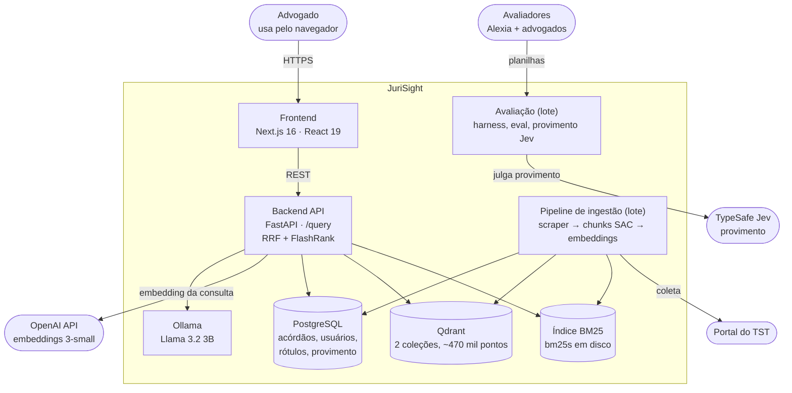
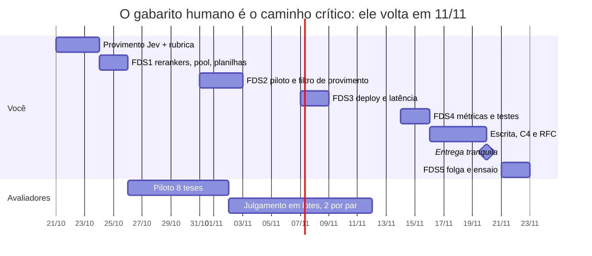

# JuriSight — Inventário técnico e plano até 20/11

Data: 2026-10-21 · Autor: Vinicius Zanatta · Versão viva: https://claude.ai/artifact/Nxz2uw1skkhKgjjgCsFapp

## Resumo

O motor de busca está pronto. Falta medir, com gabarito de profissionais, qual reranker traz os melhores acórdãos para uma tese, e colocar o vencedor em produção.

Decisões fechadas em 21/10:

- o JUÁ sai;
- o Jev fica só no provimento (já saiu do harness no código);
- não há Cohere nem fine-tuning;
- Faithfulness e Answer Relevance saem do escopo;
- cada par é julgado por duas pessoas;
- o reranker de produção só muda depois do benchmark;
- o BM25 fica sem tratamento de NLP, e o categorical sort saiu;
- o filtro de provimento passa para antes da busca, com o provimento do Jev.

**O que vamos fazer, em ordem:**

1. Fechar o provimento do Jev: ajustar as perguntas, refazer a conferência, classificar o acervo e aplicar.
2. Filtrar por provimento antes da busca: os três canais buscam só entre acórdãos do provimento escolhido.
3. Montar o gabarito em lotes: cada lote é uma tese completa (~40 pares), julgada por duas pessoas.
4. Plugar 3 rerankers novos (gte, bge e monoPTT5) ao lado do FlashRank, e um `eval` que compara todos.
5. Rodar o benchmark: nDCG@10 como métrica principal, as secundárias, intervalos de confiança e testes pareados.
6. Trocar o reranker de produção pelo vencedor.
7. Publicar o app numa VPS com painel de deploy.

**Prazo.** 4 fins de semana até 20/11 (sexta, feriado) e 21–22/11 de folga.

## Parte 1 — Visão geral e arquitetura (C4)

O JuriSight recebe o PDF do caso e a intenção do advogado e devolve jurisprudência trabalhista do TST ordenada por relevância. Hoje o acervo tem só acórdãos (69.349); súmulas, OJs e precedentes ainda não foram coletados. No nível 1 do C4 há uma pessoa (o advogado) e três sistemas externos: Portal do TST, OpenAI e TypeSafe. O desenho abaixo junta os níveis 1 e 2.

A busca do usuário vai do frontend ao backend, que consulta o Ollama, a OpenAI e os três índices. Ingestão e avaliação são processos em lote que leem e escrevem nos mesmos bancos; a avaliação roda o mesmo pipeline do backend dentro do próprio processo.

**Nível 3 do backend**, na ordem em que uma consulta passa:

1. PDF Extractor (`pdfplumber`, só em memória).
2. Query Enrichment (Llama 3.2 3B) gera a estrutura argumentativa, que o usuário revisa.
3. Query Builder monta a consulta BM25 e a frase-tese.
4. Hybrid Search: BM25, Qdrant completo e Qdrant ementa em paralelo, fundidos por RRF.
5. Doc Retriever busca os documentos no Postgres; filtros de provimento e período, aplicados depois da busca (o de provimento vai passar para dentro dos canais; veja a Parte 2).
6. Reranker (FlashRank) reordena o pool de 30 e corta em 20.
7. Result Formatter monta os cartões na ordem do reranker. O Categorical Sort saiu em 21/10, porque o acervo só tem acórdãos.

## Parte 1 — Componentes e artefatos

O JuriSight é, tecnicamente, um sistema de **recuperação** com entendimento da consulta por LLM: ele implementa o "R" do RAG e não gera texto de resposta. Isso precisa estar explícito na defesa, porque decide quais métricas fazem sentido.

### Conceitos usados

| Conceito | O que é | Onde aparece no JuriSight |
| --- | --- | --- |
| RAG (Retrieval-Augmented Generation) | Recuperar documentos reais e ancorar neles o que o LLM produz, para evitar alucinação | O LLM só estrutura a consulta; o resultado é sempre um acórdão real com número e link |
| BM25 | Ranking lexical: pontua documentos pela frequência dos termos da consulta, penalizando termos comuns | Canal lexical sobre os chunks; acha termos exatos como "NR-15" e "art. 192" |
| Busca densa (embeddings) | Texto vira vetor; documentos próximos no espaço vetorial têm sentido parecido (cosseno) | Dois canais no Qdrant: chunk completo e ementa |
| RRF (Reciprocal Rank Fusion) | Funde rankings somando 1/(60 + posição) de cada lista; usa só a posição, não o score | Funde os 3 canais em um pool de 30 documentos |
| Cross-encoder (reranker) | Modelo que lê consulta e documento juntos e dá uma nota de relevância | FlashRank `ms-marco-MultiBERT-L-12` reordena o pool do RRF |
| SAC (Summary-Augmented Chunking) | Cada pedaço do texto recebe a ementa como prefixo, para não se confundir com acórdãos parecidos | Janelas de 500 palavras com sobreposição de 80 (o último chunk pode chegar a ~900). O prefixo é a ementa cortada em 150 palavras ou, sem ementa, o dispositivo. O BM25 indexa a janela sem o prefixo |
| Poly-vector | Mais de um vetor por documento, cada um para um aspecto | Um vetor por chunk (ementa + trecho juntos) e um vetor por acórdão só da ementa, em coleções separadas |
| Query enrichment | LLM extrai do PDF e da intenção do advogado uma estrutura (pedido, normas, tese central) | Llama 3.2 3B local via Ollama; o usuário revisa antes da busca |
| LLM como juiz | Um modelo dá nota de relevância a pares (consulta, documento) no lugar de um humano | Saiu do harness em 21/10; o gabarito agora é só humano |

### Componentes

| Componente | O que faz | Implementação | C4 (container) | Código |
| --- | --- | --- | --- | --- |
| Scraper | Coleta acórdãos, súmulas, OJs e precedentes do portal do TST | `requests` com delay adaptativo (mín. 2 s), estado retomável em `scraper_state`, parser HTML por seção | Pipeline de ingestão | `scraper/` |
| Classificador de provimento (regex) | Marca APROVADO, PARCIAL, NEGADO ou NAO_APLICAVEL pelo dispositivo | Regex sobre marcadores do dispositivo | Pipeline de ingestão | `scraper/provimento.py` |
| Classificador de provimento (Jev) | Resultado do recurso, quem recorreu e a quem favorece, com probabilidades | 3 perguntas Choice ao Jev; tabela `provimento_jev`; CLI `classificar`, `comparar`, `conferir`, `aplicar`; não depende de `avaliacao/` | Pipeline de ingestão (lote) | `scraper/provimento_jev*.py` |
| Chunker SAC | Divide o texto e prefixa a ementa | Janela por palavras | Pipeline de ingestão | `processing/chunking/sac_chunker.py` |
| Embedder poly-vector | Gera os 2 vetores por chunk | OpenAI `text-embedding-3-small`, 1536 dimensões, cerca de US$ 8 para o acervo | Pipeline de ingestão | `processing/embeddings/poly_vector.py` |
| Vector store | Guarda e busca vetores | Qdrant 1.19, vetores em disco, HNSW em RAM, quantização int8 | Banco vetorial | `indexing/vector_store/qdrant_store.py` |
| Índice BM25 | Busca lexical, sem stemming nem stopwords do domínio | `bm25s`, matriz esparsa via mmap (RAM do backend de 7,4 GB para 300 MB) | Índice BM25 (arquivos) | `indexing/lexical/bm25_builder.py` |
| PDF extractor e query enrichment | Extrai texto do PDF e a estrutura argumentativa | `pdfplumber` em memória + Llama 3.2 3B | Backend + Ollama | `query/enrichment/` |
| Query builder | Monta a consulta BM25 (termos exatos) e a frase-tese (densa), sem LLM | Funções determinísticas | Backend | `query/enrichment/query_builder.py` |
| Hybrid search | 3 canais em paralelo e fusão RRF | `ThreadPoolExecutor`, k = 60, 5 candidatos por canal para cada resultado pedido | Backend | `query/search/hybrid_search.py` |
| Pipeline de busca | Busca, filtros, rerank, corte em 20 e normalização; a ordem final é a do reranker | Função `buscar()` reusada pelo `/query` e pelo `eval` | Backend | `query/search/pipeline.py` |
| Reranker | Reordena o pool de 30 | FlashRank ONNX, 8 threads, ementa truncada em 1.200 caracteres | Backend | `query/search/reranker.py` |
| API | `/enrich`, `/query`, `/document/{id}`, `/auth/*`, `/conversas`, `/avaliacao/*` | FastAPI + Uvicorn | Backend | `query/api/` |
| Autenticação e conversas | Cadastro, login, histórico versionado (V1, V2…) | Argon2id, JWT em cookie httpOnly, Postgres | Backend + Postgres | `auth/`, `conversations/` |
| Frontend | Consulta, revisão, resultados, decisão, salvos, configurações, rotulação | Next.js 16, React 19, Tailwind 4; Jest e Cypress | Frontend | `frontend/` |
| Harness de avaliação | Teses (reais e sintéticas), tema e split, pooling, fila de rotulação e `eval`; rótulos só humanos | Schema `avaliacao` no Postgres; CLIs `construir` e `eval`; tela `/avaliacao` | Ferramentas de avaliação (lote) | `avaliacao/` |

Artefatos de documentação: RFC 4.1 e 4.2 (`docs/`), diagramas C4 níveis 1, 2 e 3 e casos de uso (`docs/Diagramas/`), specs e planos do harness e do provimento (`docs/superpowers/`). **Os diagramas C4 estão desatualizados**: ainda mostram ChromaDB, `nomic-embed-text`, `rank_bm25` e Playwright.

## Parte 1 — Stack e histórico

A stack é Python 3.13 no backend e na ingestão, Next.js no frontend, e três serviços em Docker (Postgres, Qdrant, Ollama). Duas APIs externas são pagas por uso: OpenAI e TypeSafe.

| Camada | Tecnologia | Papel | Observação |
| --- | --- | --- | --- |
| Dados | PostgreSQL 16 | Fonte da verdade: documentos, usuários, conversas, schema `avaliacao`, `provimento_jev` | Docker |
| Dados | Qdrant 1.19.1 | Busca vetorial, 2 coleções (~470 mil pontos) | Migrado do ChromaDB em 13/09 |
| Dados | bm25s | Índice lexical em disco (mmap) | Migrado do `rank_bm25` em 28/09 |
| IA local | Ollama + Llama 3.2 3B | Query enrichment e resumo de PDF longo | Roda na CPU |
| IA local | FlashRank (ONNX) | Reranking | Sem PyTorch, por causa da RAM |
| IA externa | OpenAI `text-embedding-3-small` | Embeddings do acervo e da consulta | Contraria a RNF03 (tudo local); registrar como desvio |
| IA externa | OpenAI `gpt-4o-mini` | Escreve teses sintéticas e atribui o tema de cada uma | Só no harness |
| IA externa | TypeSafe Jev `jev-1.13.0` | Classificador de provimento (não é mais juiz de relevância) | Versão fixada; acesso antecipado |
| Backend | FastAPI, Uvicorn, Pydantic v2, psycopg 3 | API REST e pipeline | Gerenciado com `uv` |
| Frontend | Next.js 16.3, React 19, Tailwind 4 | Interface | pnpm |
| Testes | pytest; Jest + Testing Library; Cypress | Unitário, componente, E2E | Testes de backend rodam sem infraestrutura (fakes) |
| Infra local | Docker Compose, `run.sh`, WSL2 | Sobe tudo com um comando | Máquina com 11 GB de RAM e sem GPU |

### Histórico do que foi produzido

| Data | Marco |
| --- | --- |
| 21/10/2026 | Limpeza (branch `refactor/limpeza-projeto`): o Jev sai do harness; saem o categorical sort, `evaluation/` e `utils/import_acordaos.py`; decisão de BM25 sem NLP; spec do filtro de provimento antes da busca |
| 21/10/2026 | Provimento com o Jev mesclado em `feat/harness-avaliacao` |
| 20/10/2026 | Classificador de provimento com o Jev e primeira conferência |
| 17/10/2026 | Harness de avaliação: métricas, juiz Jev, teses, pooling, passo 0, `eval`, tela `/avaliacao` |
| 04/10/2026 | Reranking FlashRank após o RRF; conversas persistidas e versionadas |
| 28/09/2026 | Otimização: busca de 80–330 s para 3–5 s (HNSW em RAM, int8, `bm25s`) |
| 20/09/2026 | Integração frontend, backend e KPIs mesclada na `main` |
| 14/09/2026 | Autenticação real (Argon2id, JWT em cookie) |
| 13/09/2026 | Migração de ChromaDB para Qdrant |
| 06/09/2026 | Backend FastAPI com pipeline completo de busca e LLM |
| 30/08/2026 | Testes Jest e Cypress no frontend |
| 17/08/2026 | Scaffold do frontend Next.js |
| 06/08/2026 | Primeira avaliação de KPIs de recuperação (`evaluation/`, removida em 21/10) |
| 13/07/2026 | Pipeline de indexação completo (Chroma + BM25) com delta |
| 08/07/2026 | SAC Chunker com testes |
| 03/07/2026 | Provimento PARCIAL como categoria própria |
| 12/06/2026 | Modularização, extração de provimento por regex, controle de delta |
| 14/05/2026 | Scraper troca Scrapy e Playwright por `requests` |
| 25/03/2026 | Primeiro commit |

## Parte 2 — Decisões

Todas as decisões abaixo estão fechadas. Onde a escolha foi minha, e não sua, isso está marcado.

| Tema | Decisão | Por quê |
| --- | --- | --- |
| Embedding JUÁ-4B | Fora | O índice já usa a OpenAI; trocar exigiria reindexar e GPU |
| Jev | Só classificador de provimento; saiu do harness em 21/10 | Acurácia "English-first"; juízes LLM tiveram kappa de 0,32 a 0,53 contra humanos no NormasTCU. No provimento, acertou 96% contra 62% da regex |
| Métricas | Só de recuperação: nDCG@10 (principal), MRR@10, P@5, P@10, Recall@10/20, MAP@10 | Faithfulness e Answer Relevance medem resposta gerada, e o JuriSight não gera resposta. Saíram do escopo |
| Rerankers testados | gte, bge-v2-m3 e monoPTT5, contra o FlashRank e contra o sistema sem reranker | Cohere fora por privacidade; mMiniLM fora para enxugar |
| Gabarito | Profissionais, **duas pessoas por par** | Gabarito independente dos sistemas, com concordância medida em todos os pares |
| Reranker em produção | O vencedor do benchmark, trocado depois dele | Decisão baseada em dado, não em literatura de outro domínio |
| Fine-tuning | Não; fica como trabalho futuro | Veja abaixo |
| BM25 sem tratamento de NLP | Nenhum: sem stemming, lematização, stopwords do domínio ou corte de seções; o tokenizer fica como está | O BM25 existe para termos exatos (NRs, artigos, súmulas), e o canal denso já cobre as variações de forma. Stemming e lematização mexem nas palavras comuns, não nas referências; as stopwords do domínio já têm IDF perto de zero. Limitação conhecida: "NR-15" vira `nr` + `15`. Só revisitar se o benchmark mostrar o problema |
| Ordenação por hierarquia | Removida (categorical sort e `ordenar_por`) | O acervo só tem acórdãos, então a ordem final já era a do reranker; a ordenação por data continua na tela |
| Filtro de provimento | Antes da busca, nos três canais, usando o provimento do Jev | Hoje ele roda depois da busca, sobre 80 candidatos, e usa a regex, que acertou 62% |
| Perguntas do provimento (proposta, a confirmar) | Embargos acolhidos só para esclarecer e "nenhum recurso provido" contam como `nao_provido` | São os dois buracos da conferência de 20/10 |

**Por que não há fine-tuning.** Os três rerankers são pré-treinados: baixa e usa. O ajuste fino é o que mais muda o resultado na literatura. No LegalBench-RAG, um reranker pequeno foi de 0,385 para 0,742 de nDCG@10 depois do ajuste. Mas ele exige milhares de pares rotulados, separados dos pares da prova. O único dado rotulado que teremos é o próprio gabarito, com 600 a 1.100 pares. Usar esses pares para treinar e para medir invalida a medição.

O que ficou de fora está na seção Trabalho futuro, no fim da Parte 2.

## Parte 2 — Metodologia do benchmark

O benchmark segue o paradigma Cranfield: acervo fixo, teses fixas e um gabarito humano (*qrels*) único para todos os sistemas. Assim, a diferença entre as métricas reflete só a qualidade da busca, não variação de julgamento.

### 1. Teses

Há dois tipos de tese, e a diferença importa:

| Tipo | Como nasce | Problema |
| --- | --- | --- |
| Sintética (já existe no harness) | O GPT lê um acórdão e escreve uma tese a partir dele | A tese herda as palavras do acórdão, o que favorece o BM25. Não é assim que o usuário real escreve |
| Escrita por advogado | O advogado escreve a tese de um caso dele, como digitaria no JuriSight | Nenhum; é exatamente a entrada real do sistema. Só custa o tempo dele |

Pedir teses aos advogados faz sentido justamente porque o sistema parte de uma tese, não de um acórdão. A tese sintética é que é artificial. **Recomendação:** pedir de 5 a 10 teses escritas, completar com sintéticas e reportar os resultados separados por tipo.

**Quantidade:** o número final é o de lotes que voltarem até 11/11. Mínimo de 15 teses, ideal de 25 a 28. Com 15, só dá para separar diferenças de cerca de 0,08 a 0,15 de nDCG@10; com 28, de cerca de 0,06 a 0,11 (estimativa).

### 2. O que é julgado e como vira lote

Por tese, julgam-se os 30 candidatos do híbrido (exatamente o que todo reranker reordena), mais o top-10 do BM25 e o top-10 do denso. Dá cerca de 40 pares por tese, e o top-10 de qualquer reranker fica 100% julgado.

- **Um lote = uma tese completa (~40 linhas)**, não 50 linhas soltas. Um lote que volta vira uma tese utilizável; 50 linhas soltas podem deixar duas teses pela metade, e uma tese pela metade não serve para medir.
- Cada lote vai para duas pessoas. A ordem das linhas é sorteada dentro do lote.
- **Custo por tese:** ~40 pares × 2 pessoas = 80 julgamentos, cerca de 40 min de cada pessoa. 15 teses dão 1.200 julgamentos; 28 teses, 2.240.
- Os 3 ou 4 primeiros lotes são o **piloto**: servem para ajustar a rubrica antes de mandar o resto.

### 3. Como se julga

| Nota | Significado (adaptado do JurisTCU e do UMBRELA) |
| --- | --- |
| 0 | Outro problema jurídico |
| 1 | Mesmo ramo ou tema, mas outro pedido ou fato central |
| 2 | Mesmo pedido, mas o fato decisivo é diferente ou só se aplica em parte |
| 3 | Mesmo problema jurídico e mesmo fato decisivo: eu citaria na peça |

- *Stance* (fortalece, enfraquece, neutro) é perguntado só quando a nota é 2 ou 3.
- O avaliador não sabe qual sistema trouxe o acórdão e nunca vê nota de LLM.
- Ele vê a ementa (ou o dispositivo, quando não há ementa), os primeiros 3.000 caracteres da fundamentação e o link do TST.
- Planilha `.xlsx` com as abas Instruções, Rubrica (um exemplo por nota), Avaliador e Avaliação. Colunas da aba Avaliação: tese, número do processo, ementa, trecho, link, nota, stance e comentário.

### 4. Duas pessoas por par: concordância e rótulo final

- **Concordância, em todos os pares:** kappa de Cohen ponderado quadrático, alfa de Krippendorff ordinal e AC2 de Gwet. O AC2 aguenta melhor quando quase tudo é nota 0. Como referência, entre especialistas do NormasTCU o kappa ficou entre 0,55 e 0,73.
- **Rótulo final** (escolha minha): notas iguais ficam como estão; se diferirem em 1 ponto, vale a menor; se diferirem em 2 ou mais, ou se o stance for diferente, a Alexia decide. Os rótulos brutos ficam guardados.
- **Robustez:** recalcular o ranking dos sistemas só com as notas de cada avaliador. Se a ordem dos sistemas se mantiver (tau de Kendall alto), a conclusão não depende de quem julgou.

### 5. Métricas

| Métrica | Relevância usada | Papel |
| --- | --- | --- |
| nDCG@10 | Nota de 0 a 3 (ganho 2^nota − 1) | **Principal**: qualidade da ordem no topo |
| MRR@10 | Nota ≥ 2 | Posição do primeiro acórdão útil |
| P@5 e P@10 | Nota ≥ 2 | KPIs do RFC (metas 0,70 e 0,60) |
| Recall@10 e @20 | Nota ≥ 2, relativo ao pool | Cobertura |
| MAP@10 | Nota ≥ 2 | Consistência ao longo do top-10 |
| Judged@10 | — | Fração julgada do top-10; precisa dar ~100% |

P@10 e MRR variam de 2 a 4 vezes mais que o nDCG (Urbano et al., 2019), então pesam menos nas conclusões. O cálculo usa `ranx` ou `ir_measures`, que batem com o `trec_eval`.

**Duas medidas de diagnóstico**, sem julgamento extra, dizem onde está o problema:

- **Teto dos rerankers:** o nDCG@10 que se teria ordenando perfeitamente os 30 candidatos do híbrido. Se o teto for alto e os rerankers ficarem longe dele, o problema é de ordenação, e um reranker melhor resolve.
- **Relevantes perdidos pela busca inicial:** quantos acórdãos com nota 2 ou 3 o BM25 ou o denso acharam e ficaram fora dos 30 do híbrido. Se forem muitos, a primeira etapa deixa coisa para trás, e isso é o argumento a favor de um loop que reformula e busca de novo (veja Trabalho futuro).

### 6. Estatística

Todo teste é pareado por tese. O teste principal é o t pareado com correção de Holm; o Wilcoxon com Benjamini-Hochberg serve de checagem. A literatura diverge sobre qual dos dois é melhor (veja Referências). Se os dois discordarem, a diferença conta como não resolvida.

Cada comparação é reportada como diferença de nDCG@10 com intervalo de confiança de 95%. "Não significativo" quer dizer "não dá para afirmar", não "empate".

## Parte 2 — Sistemas comparados

São 7 sistemas: dois de referência, a linha de base sem reranker, o FlashRank de hoje e 3 rerankers novos. Do S3 ao S6, todos reordenam os mesmos 30 candidatos do híbrido e recebem a mesma entrada (frase-tese contra a ementa cortada em 1.200 caracteres), então a comparação isola o modelo. Cada reranker é um adaptador com a interface `rerank_scores` que já existe em `query/search/reranker.py`.

| ID | Sistema | Licença | Tempo vs. hoje (40 pares, CPU local) | Como roda |
| --- | --- | --- | --- | --- |
| S0 | BM25 sozinho | — | — | Já existe (referência) |
| S1 | Denso sozinho (OpenAI, 2 coleções) | — | — | Já existe (referência) |
| S2 | Híbrido RRF, sem reranker | — | — | **Linha de base**; um parâmetro em `buscar()` |
| S3 | S2 + FlashRank `ms-marco-MultiBERT-L-12` | CC-BY-SA 4.0 | 1,0× | O sistema de hoje |
| S4 | S2 + [`gte-multilingual-reranker-base`](https://huggingface.co/Alibaba-NLP/gte-multilingual-reranker-base) | Apache 2.0 | ~1,3× | ONNX int8, sem PyTorch; lê até 8 mil tokens |
| S5 | S2 + [`bge-reranker-v2-m3`](https://huggingface.co/BAAI/bge-reranker-v2-m3) | Apache 2.0 | ~3,7× | ONNX int8, sem PyTorch |
| S6 | S2 + [`unicamp-dl/monoptt5-base`](https://huggingface.co/unicamp-dl/monoptt5-base) | Apache 2.0 | não medido | Biblioteca `rerankers` com PyTorch; o único treinado em português |

Os tempos vêm de uma medição única na máquina do projeto e valem como ordem de grandeza. O reranker de hoje gasta ~2,3 tokens por palavra em português jurídico e corta o par em 512 tokens, então lê menos da ementa que os novos.

**O que esperar, pela literatura.**

- Nenhum cross-encoder foi avaliado em jurisprudência brasileira. O que o JUÁ e o artigo de Fusão Híbrida (STIL 2026) chamam de "rerank" é um modelo de embedding dando nova nota ao top do BM25. No STIL 2026, esse rerank empatou estatisticamente com a fusão RRF.
- Fora do Brasil, rerankers treinados em inglês e limitados a 512 tokens **pioraram** a busca jurídica: no CLERC, o R@10 caiu de 8,4 para 4,2–5,1; no LegalBench-RAG, o recall caiu em todos os k.
- Sobre uma primeira etapa forte, o ganho realista de um bom reranker fica entre +0,01 e +0,06 de nDCG@10 (Kanon 2 no CanLegalRAGBench).

Por isso a linha de base sem reranker (S2) é essencial: o resultado pode ser que nenhum reranker ajude.

**Comparações registradas antes de ver os dados:**

1. S3 contra S2: o reranker de hoje ajuda?
2. S4, S5 e S6, cada um contra S3: algum novo ganha do atual? (Holm sobre as três)
3. S0 contra S1 contra S2: léxico, denso ou híbrido?

**Como o vencedor vai para produção:** entra o de maior nDCG@10. Se dois não tiverem diferença estatisticamente clara, entra o mais rápido e mais simples de rodar (escolha minha). O que muda em produção depende de quem ganhar:

| Vencedor | O que muda em produção |
| --- | --- |
| gte (S4) | Só o adaptador ONNX; quase o mesmo tempo de hoje |
| bge (S5) | Para caber no tempo de resposta, reordenar só o top-20 ou cortar o texto em 256 tokens |
| monoPTT5 (S6) | Adiciona o PyTorch ao backend, com ~1 a 2 GB de RAM a mais (estimativa); cabe numa VPS de 16 GB |
| Nenhum ganha do S3 | Mantém o FlashRank, e isso também é um resultado |

Em qualquer caso, medir a latência p95 no servidor antes de trocar. A meta do RFC é a busca inteira abaixo de 15 s.

## Parte 2 — Provimento com o Jev e filtro antes da busca

O provimento que o advogado escolhe passa a valer dentro da busca, e não depois dela, e passa a vir do Jev. O detalhe está em `docs/superpowers/specs/2026-10-21-provimento-jev-filtro-design.md`. O benchmark de rerankers roda sem filtro, então as duas frentes não se atrapalham.

**Por quê.** Hoje o híbrido traz 80 candidatos e só depois descarta os de outro provimento. Se o provimento pedido é raro entre eles, sobra pouco resultado, e o reranker ainda pontua tudo. Além disso, o filtro usa a regex, que acertou 62% contra 96% do Jev.

**Parte A — fechar o provimento do Jev** (operação, quase sem código):

1. Ajustar as perguntas nos dois casos da conferência. Isso muda o `perguntas_sha`, e os 90 já classificados voltam a ficar pendentes.
2. Nova conferência em 50 acórdãos. Seguir só com ≥ 90% de acerto no provimento e nenhum erro nos dois casos.
3. Lote cronometrado de 500 e depois `classificar` no acervo (69.349 acórdãos, ~110 M tokens).
4. `comparar`, `conferir` e `aplicar --confianca-min 0.8 --confirmar`. Abaixo de 0,8, fica o valor da regex.

**Parte B — filtrar antes da busca** (código):

1. Subcomando `sincronizar`: leva `documentos.provimento` ao payload das duas coleções do Qdrant e a um array paralelo aos chunks do BM25. Usa `set_payload`, sem reindexar nem chamar a OpenAI, e cria índices `keyword` em `provimento` e `documento_id`.
2. BM25 com máscara (`weight_mask` do `bm25s`), descartando os resultados de score 0.
3. `HybridSearch.search` passa o provimento aos três canais.
4. Em `buscar()`, com só o filtro de provimento o pool volta a 30; `aplicar_filtros` continua como rede de segurança.
5. Sem filtro, resultado e latência ficam iguais aos de hoje.

**Como medir.** Para as teses do conjunto-ouro, buscar com cada provimento (APROVADO, PARCIAL, NEGADO), antes e depois, e comparar três coisas: quantos resultados voltam (meta: 10 sempre que a base tiver 10), a latência e se 100% dos resultados têm o provimento pedido.

## Parte 2 — Cronograma até 20/11

O caminho crítico é o julgamento humano. Por isso o piloto sai no primeiro fim de semana, antes de qualquer reranker novo estar pronto: o pool só depende dos 30 candidatos do híbrido e do BM25 e denso, que já existem.

### Hoje (21/10)

- [x] Mesclar `feat/provimento-jev` em `feat/harness-avaliacao` (feito em 21/10).
- [x] Limpeza do projeto e spec do filtro de provimento (branch `refactor/limpeza-projeto`).
- [ ] Ajustar as perguntas do provimento e refazer a conferência com 50 acórdãos novos.
- [ ] Lote cronometrado de 500 e `classificar` no acervo.
- [ ] Escrever a rubrica de 0 a 3 com um exemplo por nota.
- [ ] Convidar os avaliadores e pedir de 5 a 10 teses escritas por advogados.

### FDS1 (24–25/10)

- [ ] Provimento: `comparar`, `conferir` e `aplicar --confianca-min 0.8 --confirmar`.
- [ ] Ajustar o pooling para os 30 candidatos do híbrido + top-10 do BM25 + top-10 do denso (hoje é o top-20 de três corredores).
- [ ] Congelar índice e candidatos; gerar as runs de S0 a S3; montar o pool de cada tese.
- [ ] `planilha.py exportar` (um lote por tese, para duas pessoas) e `importar`; enviar os 3 ou 4 lotes do piloto.
- [ ] Adaptadores do gte e do bge (ONNX) e script do monoPTT5 (PyTorch).
- [ ] `eval` multissistema: todas as métricas, saída por tese, latência.

### FDS2 (31/10–02/11)

- [ ] Importar o piloto; medir a concordância; ajustar a rubrica.
- [ ] Enviar os lotes restantes, com prazo até 11/11.
- [ ] Filtro de provimento antes da busca (Parte B): `sincronizar`, índices no Qdrant, máscara no BM25, `buscar()` e a medição com e sem filtro.

### FDS3 (07–08/11)

- [ ] Deploy: VPS, Coolify, restauração dos dados, busca de teste.
- [ ] Latência p95 dos 3 rerankers no servidor.

### FDS4 (14–15/11)

- [ ] Importar os lotes, aplicar a regra do rótulo final e rodar métricas, testes e intervalos de confiança.
- [ ] Escolher o vencedor e trocá-lo em produção.

### Semana de 16–20/11

- [ ] Atualizar C4, RFC (KPIs sem RAGAS, RNF03, decisões) e README; escrever o capítulo de resultados.
- [ ] 21–22/11: folga, revisão e ensaio.

## Parte 2 — Deploy, riscos e o que falta decidir

### Deploy

Recomendação: **uma VPS de 16 GB com o [Coolify](https://coolify.io) instalado.** O Coolify é um painel aberto, estilo Heroku, que roda no seu próprio servidor. Você conecta o GitHub, ele sobe o `docker-compose`, emite o HTTPS e agenda o backup do Postgres. Tudo pela interface, sem administrar o Linux no dia a dia.

Por que não uma nuvem gerenciada "mais simples", como Render, Railway, Fly.io ou Vercel:

- o JuriSight tem 5 serviços, usa ~7 a 9 GB de RAM e ~2,5 GB de vetores em disco, e roda o Ollama na CPU;
- nessas plataformas, RAM e disco persistente são caros, e o Ollama não cabe nos planos pequenos;
- quebrar em vários serviços gerenciados (Qdrant Cloud, Postgres gerenciado, Vercel) dá mais contas e mais peças para gerenciar, não menos.

| Item | Escolha |
| --- | --- |
| Máquina | 4 vCPU, 16 GB de RAM, ~80 GB de disco (Hetzner, VPS no Brasil ou AWS Lightsail; conferir o preço na hora) |
| Painel | Coolify; alternativa sem painel: Docker Compose + Caddy |
| Dados | `pg_dump`/`pg_restore`, snapshot do Qdrant e cópia do índice BM25, sem reindexar |
| Segredos | `.env` só no servidor (OpenAI, TypeSafe, JWT) |
| Backup | Postgres diário, agendado no painel |

### Riscos

| Risco | Mitigação |
| --- | --- |
| Poucos lotes voltam até 11/11 | Lotes de uma tese inteira; mandar o piloto já no FDS1; mínimo de 15 teses |
| Duas pessoas por par dobram o custo | Cada lote leva ~40 min por pessoa; repartir os lotes entre mais gente |
| Concordância baixa no piloto | Revisar a rubrica com a Alexia; se precisar, juntar as notas 1 e 2 |
| Diferenças pequenas demais para medir | Reportar a diferença com intervalo de confiança; "não resolvido" também é resultado |
| Vencedor lento ou pesado em produção | Medir a p95 no servidor; top-20 ou 256 tokens; ver a tabela de produção em Sistemas |
| Nova conferência do provimento abaixo de 90% | Parar antes do `classificar` e rever as perguntas; o filtro continua com a regex até lá |
| Índices dessincronizados do Postgres | `sincronizar` idempotente depois de cada `aplicar`; `aplicar_filtros` como rede de segurança |
| Acervo ou índice mudam no meio do benchmark | Congelar e registrar contagens e commit antes de montar o pool; rodar o `sincronizar` antes disso |

### O que ainda falta decidir

- [ ] Quantos advogados topam escrever teses (5 a 10 seria o ideal)?
- [ ] Você concorda com a regra do rótulo final (diferença de 1 ponto: vale a menor nota; 2 ou mais: a Alexia decide)?
- [ ] Você confirma as duas mudanças nas perguntas do provimento (embargos só para esclarecer e "nenhum recurso provido" como `nao_provido`)?
- [ ] Qual provedor de VPS, e se há domínio próprio?
- [ ] Onde estão o banco e os índices? O clone usado nesta análise não tem `.env` nem `data/`.

## Parte 2 — Trabalho futuro

Nada disto entra até 20/11. Cada item traz uma razão para ficar de fora e, quando existe, o dado do benchmark que justificaria retomá-lo.

| Ideia | Por que fica para depois | O que no benchmark justificaria |
| --- | --- | --- |
| Fine-tuning do reranker (gte) com pares tese × ementa | Exige milhares de pares rotulados, separados da prova. No LegalBench-RAG, um reranker pequeno ajustado foi de 0,385 para 0,742 de nDCG@10 | Rerankers prontos ficarem longe do teto dos 30 candidatos |
| Ementa inteira no SAC e na coleção `ementa` | Hoje a ementa é cortada em 150 palavras (herança do `nomic`; o `text-embedding-3-small` aceita 8.191 tokens), então o canal `ementa` só vê o começo das ementas longas. Corrigir exige reembutir as coleções, e fazer isso depois do gabarito invalida a comparação | Relevantes com ementa longa ficarem fora dos 30 candidatos |
| Medir o prefixo SAC (com e sem a ementa no chunk) | A ementa ocupa até 150 das ~650 palavras de cada chunk, e o RRF pode contar duas vezes o sinal da ementa. Medir exige reembutir os ~400 mil chunks e julgar os acórdãos novos que aparecerem | — |
| Loop agêntico: decompor a tese, checar se cada aspecto tem acórdão relevante e buscar de novo quando faltar | Traz acórdãos de fora do pool (julgamento novo), precisa de um crítico confiável e tem pouca evidência em jurisprudência | Muitos relevantes perdidos pela busca inicial |
| Busca por aspecto da tese (pedido, tese central e normas) fundida por RRF | Muda o conjunto de candidatos, então exige julgamento novo | Idem |
| Busca separada por seção do acórdão (ementa, fundamentação, dispositivo) | Exige índices novos e julgamento novo | Idem |
| Usar o `favorece` do Jev para ordenar ou filtrar | Precisa do lado que o advogado representa na tese | Fortalece@10 baixo no benchmark |
| Filtro de período antes da busca | O Qdrant suporta, mas o período continua depois da busca por ora | — |
| Colapsar resultados do mesmo processo no top-10 | É outro trabalho; foi discutido no design do filtro | Top-10 com vários acórdãos do mesmo processo |
| Rerankers com raciocínio (ReasonRank) | 10 a 20 min por consulta nesta CPU; avaliados só em inglês | — |
| Geração de resposta com citações, medida com Faithfulness e Answer Relevance | O JuriSight hoje só recupera documentos | — |

## Referências

Links conferidos em 21/10/2026. Na coluna Status: "Aberto" = a página foi lida; "Só DOI" = o link leva à editora, mas o texto fica atrás de login; "Não aberto" = citado sem leitura nesta pesquisa.

### Metodologia de avaliação

| Etapa | Referência | Status |
| --- | --- | --- |
| Fundamentos | [Manning, Raghavan e Schütze, *Introduction to IR*, cap. 8 (2008)](https://nlp.stanford.edu/IR-book/html/htmledition/evaluation-in-information-retrieval-1.html) | Aberto |
| Fundamentos | [Voorhees, "Variations in relevance judgments and the measurement of retrieval effectiveness", IP&M (2000)](https://doi.org/10.1016/S0306-4573(00)00010-8) | Só DOI |
| Pooling | [Zobel, "How reliable are the results of large-scale IR experiments?", SIGIR (1998)](https://people.eng.unimelb.edu.au/ammoffat/sigir98/abstracts/zobel.html) | Aberto |
| Pooling | [Losada, Parapar e Barreiro, bandits para julgamento em pooling, IP&M (2017)](https://citius.usc.es/investigacion/publicacions/listado/multi-armed-bandits-adjudicating-documents-pooling-based-evaluation-ir-systems) | Aberto |
| Número de teses | [Webber, Moffat e Zobel, poder estatístico em avaliação de RI, CIKM (2008)](https://people.eng.unimelb.edu.au/ammoffat/abstracts/wmz08cikm.html) | Aberto |
| Número de teses | [Sakai, "Topic set size design", Information Retrieval Journal (2016)](https://link.springer.com/article/10.1007/s10791-015-9273-z) | Aberto |
| Teses sintéticas | [Consultas geradas a partir do documento favorecem o BM25 (arXiv 2204.12755)](https://arxiv.org/pdf/2204.12755) | Aberto |
| Julgamento incompleto | [Sakai e Kando, métricas com listas condensadas, IRJ (2008)](https://link.springer.com/doi/10.1007/s10791-008-9059-7) | Aberto |
| Escala 0–3 | [Upadhyay et al., UMBRELA (2024)](https://arxiv.org/abs/2406.06519) | Aberto |
| Jurídico PT | [Fernandes et al., JurisTCU, Language Resources and Evaluation (2026)](https://doi.org/10.1007/s10579-025-09881-w) e [dataset](https://huggingface.co/datasets/LeandroRibeiro/JurisTCU) | Só DOI; dataset aberto |
| Jurídico PT | [Fernandes et al., NormasTCU e LLM como juiz (2026)](https://arxiv.org/abs/2608.27746), [IP&M](https://doi.org/10.1016/j.ipm.2026.105151) e [dataset](https://huggingface.co/datasets/LeandroRibeiro/NormasTCU) | Aberto |
| Jurídico PT | [Pereira et al., benchmark JUÁ (2026)](https://arxiv.org/abs/2604.06098) | Aberto |
| Estatística | [Smucker, Allan e Carterette, comparação de testes de significância, CIKM (2007)](https://ciir-publications.cs.umass.edu/getpdf.php?id=744) | Aberto |
| Estatística | [Urbano, Lima e Hanjalic, erros tipo I, II e III em RI, SIGIR (2019)](https://arxiv.org/abs/1905.11096) | Aberto |
| Estatística | Parapar, Barreiro, Presedo-Quindimil e Losada, testes de significância por distribuição de scores, JASIST (2019), na [página do autor](https://www.dc.fi.udc.es/~parapar/) | Resumo aberto |
| Estatística | [Otero, Parapar e Barreiro, "Towards Reliable Testing for Multiple IR System Comparisons", ECIR (2025)](https://doi.org/10.1007/978-3-031-88711-6_27) | Só DOI; recomendação não confirmada |
| Estatística | [Carterette, testes múltiplos em experimentos de RI, TOIS (2012)](https://doi.org/10.1145/2094072.2094076) | Só DOI |
| Estatística | Benjamini e Hochberg, "Controlling the false discovery rate", JRSS B 57(1) (1995) | Citação clássica, sem link conferido |
| Ferramentas | [trec_eval](https://github.com/usnistgov/trec_eval), [ranx](https://github.com/AmenRa/ranx), [ir_measures](https://github.com/terrierteam/ir_measures), [pytrec_eval](https://github.com/cvangysel/pytrec_eval) | Aberto |
| RAG (fora do escopo) | [Upadhyay et al., visão geral do TREC 2025 RAG Track](https://arxiv.org/abs/2603.09891) e [site](https://trec-rag.github.io/trec25/) | Aberto |

### Rerankers e evidência em busca jurídica

| Tema | Referência | Status |
| --- | --- | --- |
| Reranker atual | [FlashRank](https://github.com/PrithivirajDamodaran/FlashRank) | Aberto |
| S4 | [gte-multilingual-reranker-base](https://huggingface.co/Alibaba-NLP/gte-multilingual-reranker-base) e [versão ONNX](https://huggingface.co/onnx-community/gte-multilingual-reranker-base/tree/main/onnx) | Aberto |
| S5 | [bge-reranker-v2-m3](https://huggingface.co/BAAI/bge-reranker-v2-m3); MIRACL na [tabela da Jina](https://huggingface.co/jinaai/jina-reranker-v3) | Aberto |
| S6 | [monoptt5-base](https://huggingface.co/unicamp-dl/monoptt5-base) e [artigo do monoPTT5 e do Quati (2024)](https://arxiv.org/html/2406.10806) | Aberto |
| Descartados | [Qwen3-Reranker-0.6B](https://huggingface.co/Qwen/Qwen3-Reranker-0.6B) (lento em CPU); [ReasonRank](https://arxiv.org/html/2508.07050v3) (precisa de GPU); [jina-reranker-v3.5](https://huggingface.co/jinaai/jina-reranker-v3.5) (licença não comercial) | Aberto |
| Controle lexical | [CXM25](https://github.com/cnmoro/CXM25) e [arara-rag](https://pypi.org/project/arara-rag/); ganhos só do próprio autor | Aberto |
| Evidência BR | [Fusão Híbrida para RI jurídica brasileira, STIL (2026)](https://sol.sbc.org.br/index.php/stil/article/view/44630) | Aberto |
| Evidência internacional | [CLERC (2024)](https://arxiv.org/pdf/2406.17186); [LegalBench-RAG (2024)](https://arxiv.org/html/2408.10343v1); [CanLegalRAGBench (2026)](https://arxiv.org/pdf/2605.30497) | Aberto |
| Fine-tuning | [Reranker de 150M ajustado no LegalBench-RAG](https://huggingface.co/lxyuan/LegalBenchRAG-Ettin-150M-Reranker) | Aberto |
| Atalho de categoria | [Auditoria do LeCaRDv2 (2026)](https://arxiv.org/abs/2606.12993) | Aberto |
| Deploy | [Coolify](https://coolify.io) | Não aberto |

### Documentos do projeto

| Documento | Caminho |
| --- | --- |
| Este documento (cópia no repositório) | `docs/superpowers/specs/2026-10-21-inventario-e-plano-design.md` e `.html` |
| Provimento com o Jev e filtro antes da busca | `docs/superpowers/specs/2026-10-21-provimento-jev-filtro-design.md` |
| Provimento com o Jev: design, plano e conferência de 20/10 | `docs/superpowers/specs/2026-10-20-provimento-jev-design.md`, `docs/superpowers/plans/2026-10-20-provimento-jev.md`, `docs/superpowers/specs/2026-10-20-provimento-jev-conferencia.md` |
| Harness de avaliação (versão de 17/10, antes da saída do Jev) | `docs/superpowers/specs/2026-10-17-harness-avaliacao-design.md` |
| RFC e diagramas | `docs/RFC 4.2.md`, `docs/Diagramas/` |

**Removidos do material recebido** por estarem errados ou não carregarem:

- "Evaluating ranking for a given query": o link da ACL leva a outro artigo, uma revisão de *learning-to-rank* em PLN.
- "Variations in Relevance Judgments and the Shelf Life of Test Collections": o arXiv 2010.15499 é um artigo de matemática.
- O relatório técnico TR140704 deu erro 404.
- Os slides de Schaer (CLEF 2012), o PDF "Growing up in Cranfield" e a revisão de Joseph e Ravana não carregaram.
- BAGEL e HALT, citados no material sobre RAG agêntico, não foram conferidos.
